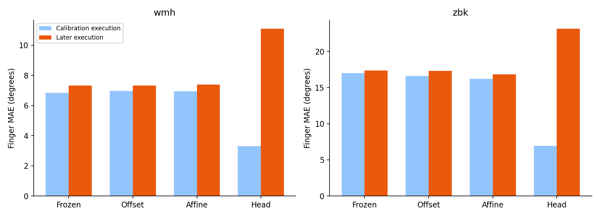
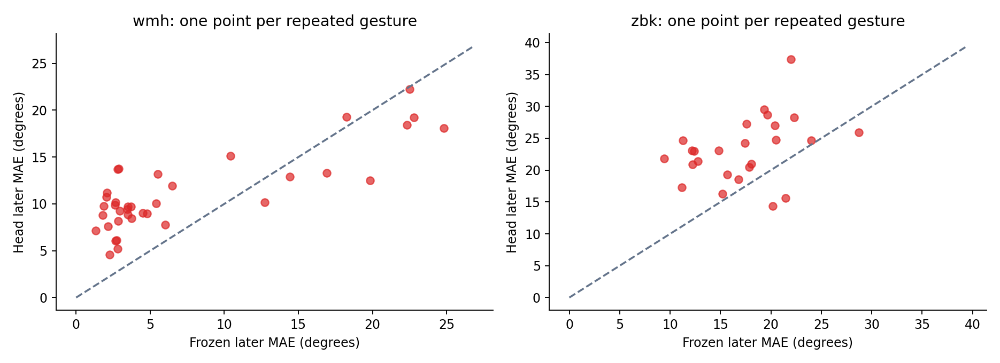
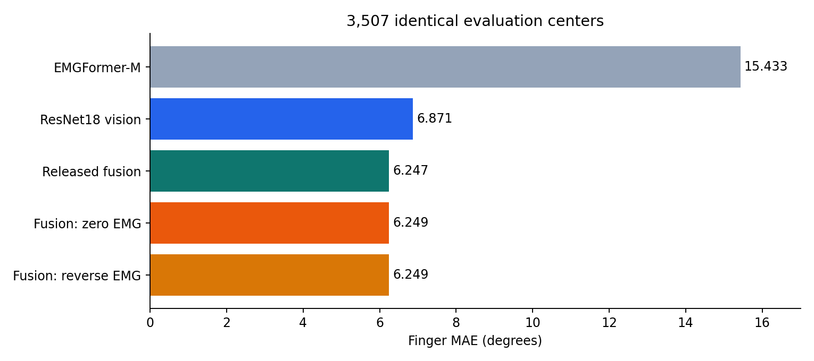
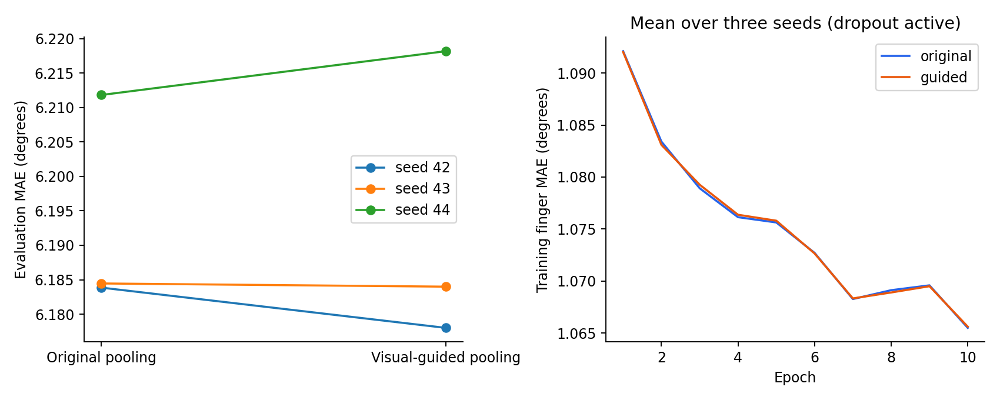

# 重复动作校准与视觉—EMG 融合：实验验证报告

日期：2026-10-14（Asia/Tokyo）。范围：本地 EgoEMG 预览包、右手、发布 checkpoint。所有数据均直接读取 D 盘；新增脚本、预测、参数、日志、图片与报告均在 `myself/`。本报告的分数均为 20 个手指关节的角度 MAE，越低越好。

## 1. 本轮结论与研究决策

**暂时停止把当前输出层 Head 校准作为主线。** 在两位参与者的独立重复动作中，Head 都能明显降低拟合误差，却恶化后一次执行：wmh 从 7.321° 到 11.107°，zbk 从 17.376° 到 23.158°；三个 seed 都同向变差。这支持“这套设置的迁移失败”，不能推广为所有个性化方法无效。

**Affine 保留为低优先级对照。** zbk 上改善约 0.549°（18/25 类动作改善），wmh 上恶化约 0.066°（11/37 类改善）。收益依参与者而异，尚不适合直接加入主架构。

**融合值得继续研究，但当前发布模型的优势还不能等同于 EMG 互补性。** 共同样本上 vision-only 6.871°、融合 6.247°，相对改善 9.07%；然而把 EMG 置零后仍是 6.249°，预测本身的平均变化也只有 0.0313°。需要优先回答“怎样让融合可靠地使用 EMG”，再谈复杂交互结构。

已完成一个固定编码器的小规模结构对照。三 seed 的原聚合均值 6.193379°，视觉引导聚合均值 6.193396°，配对平均变化 +0.000017°，几乎为零，seed 方向不一致。**该结构改动本轮没有获得实际增益。** 这是单参与者、固定预算的可行性试验；不能据此断言所有视觉引导方法都无效。

## 2. 对原对话的事实核对

旧实验原始 CSV 的冻结值为 15.349226°，真值 Head 为 15.638044°，增加 0.288818°，约 1.88%。它测试跨动作迁移；本轮测试同动作的后一次独立执行，样本群体不同，不能直接比较两轮 MAE 的高低。

旧 RGB teacher 的约 1.76° 来自校准池。本轮单独测得评估池共同子集上的视觉 MAE 为 6.870505°。不能把 1.76° 作为目标评估性能。

核对原始文献后，EgoEMG 的残差融合描述成立，其 EMG 特征先做时间注意力池化，再与视觉特征结合。[EgoEMG §4.5](https://arxiv.org/html/2605.05712v1)。EVFormer 的正确独立链接是 [arXiv:2610.06970](https://arxiv.org/abs/2610.06970)，其摘要描述双向交互，但报告的是单参与者可行性结果。原对话给出的 2605.05712 是 EgoEMG 的链接。REACT 的用户嵌入与 FiLM 描述可在[原论文摘要](https://arxiv.org/abs/2605.30127)核对；本轮没有复现 REACT，也没有复现 EVFormer。

## 3. 重复动作校准：协议

从 `label_gesture_class` 与 `label_gesture_active` 的逐行连续段定义一次动作执行。split 标签变化不会产生“新执行”；连续同类片段也不会被人为切成两个重复。每类只取最早两段，不按预测误差选择。所有 12,000 行窗口必须完整位于该动作段中；stride=200，中心标签有效且有限，全部 EMG 输入有限。窗口名义跨度 6 秒，中心间隔 0.1 秒。

所有拟合窗口的最晚结束都不晚于任何评估窗口的最早开始；按半开区间检查完整输入支持，包含前后文隔离。wmh 有 37 类合格重复动作，zbk 有 25 类；第三位 wsj 的预览录制中没有同类第二次执行，因此没有替换样本或伪造时间切分。

| 参与者 | 动作类数 | 拟合中心数 | 后次评估中心数 | 拟合支持并集（秒） | 后次支持并集（秒） |
| --- | --- | --- | --- | --- | --- |
| wmh | 37 | 1482 | 1461 | 366.5 | 364.4 |
| zbk | 25 | 1001 | 993 | 247.6 | 246.8 |

这些秒数按 2,000 Hz 行数计算，不是墙钟时间；同段窗口重叠，不代表独立重复样本。也不是“几秒钟短校准”实验。原始数据 split 留在 manifest 中；本次时间适配协议允许使用第一次执行的官方 user/gesture/both 行作校准，**不属于官方 benchmark**。

模型与旧套件一致：发布 EMGFormer-M、8 通道右手 filtered_paper、同一 per-channel normalization、FP32 且关闭 TF32、不做增广。使用完整线性时间插值对齐后的输入中心，截取实际最后一层 Linear 的输入，逐批验证其输出与原预测等价。

Offset λ=1；Affine λ_a=0.01、λ_b=1，低方差回退；Head 只更新最后 Linear 的 20 个手指行和偏置（10,260 参数），不更新腕部或编码器。每个 seed=42/43/44 都从同一发布权重开始，Adam lr=0.001，50 epochs，batch=256，初始化偏移正则=0.001，固定最后 epoch。Head 的“均值”是三个模型 MAE 的平均，**不是预测集成的 MAE**。

## 4. 重复动作校准：结果与解释

| 参与者 | 方法 | 后次执行 MAE（°） | 相对冻结差值（°） | seed 样本SD（°） | 改善动作类数 |
| --- | --- | --- | --- | --- | --- |
| wmh | frozen | 7.321 | +0.000 | — | — |
| wmh | offset | 7.332 | +0.011 | — | 11/37 |
| wmh | affine | 7.387 | +0.066 | — | 11/37 |
| wmh | head | 11.107 | +3.787 | 0.022 | 8/37 |
| zbk | frozen | 17.376 | +0.000 | — | — |
| zbk | offset | 17.316 | -0.060 | — | 14/25 |
| zbk | affine | 16.827 | -0.549 | — | 18/25 |
| zbk | head | 23.158 | +5.782 | 0.025 | 3/25 |



Head 的拟合与迁移情况：

| 参与者 | 拟合段冻结（°） | 拟合段 Head（°） | 后次执行 Head（°） |
| --- | --- | --- | --- |
| wmh | 6.850 | 3.312 | 11.107 |
| zbk | 17.010 | 6.932 | 23.158 |

拟合本身能下降，因而不能用“优化器没有工作”解释后次退化。现象符合过拟合或执行间表征/目标关系变化，但本轮没有识别其具体生理或信号原因。Offset/Affine 拟合的是正则化 MSE，其 MAE 不保证单调改善；wmh 拟合 MAE 小幅上升不自动表示实现错误。



为避免长片段支配总体，另按动作等权计算宏平均差值，并做动作类别上的配对 bootstrap（10,000 次）：

| 参与者 | 方法 | 宏平均差值（°） | 描述性95%区间（°） |
| --- | --- | --- | --- |
| wmh | affine | +0.059 | [-0.081, +0.189] |
| wmh | head | +3.692 | [+2.195, +5.101] |
| zbk | affine | -0.548 | [-0.828, -0.264] |
| zbk | head | +5.810 | [+3.613, +7.897] |

区间仅描述这批录制中的动作类别变动，不能当作跨参与者总体置信区间；同一人的动作并不严格独立。每个动作的名称、中心数和误差保存在 `repeated_gesture_class_summary.csv`。

## 5. 共同样本上的模态与残差诊断

从旧评估池固定的 3,654 个中心出发，要求 RGB 映射非负、非 stale、|delta|≤50 ms、右手 crop 可解码且预处理有限。147 个中心缺失 crop，最终共同集 3,507；没有按标签误差筛选。所有模型使用完全相同的中心、手指真值和掩码。EMG-only 在这 3,507 个中心上的值是 15.433°，因此不能与旧全部 3,654 个中心的 15.349°混用。

| 条件 | 共同集 MAE（°） |
| --- | --- |
| emg | 15.433340 |
| vision | 6.870505 |
| fusion | 6.247280 |
| fusion_vision_branch | 12.326312 |
| fusion_zero_emg | 6.248543 |
| fusion_reverse_time | 6.248819 |



发布融合比独立 ResNet18 改善 0.623°；但独立训练 checkpoint 的差异包含训练后的视觉表征和额外视觉路径，不能仅归因于交互。融合内部视觉分支为 12.326°，残差路径仍接收视觉特征；因而“大残差改善”也不证明来自 EMG。

将归一化后的 EMG 模型输入置零，MAE 变化 +0.001263°；时间反转后变化 +0.001539°。这不等同于物理肌肉完全静息。置零/反转是诊断干预，可能偏离训练分布，不能代替重新训练的严格消融；但它们足以提示该预览样本中的 EMG 依赖很弱。

预处理保留各发布模型的配置：EMG-M 为 8ch、WL=12,000、按通道/手归一化；发布 RN18+EMG-S 融合为 WL=7,790、16 槽位布局（8 路右手信号置于 [10,12,0,1,2,4,5,6]，其余零填充）、`channel_interpolate=false`、原 `per_dataset_norm_stats.json` 中 legacy 标量统计。**16 槽位并不表示双手 EMG。** 三个模型的输入表示和规模不同，所以共同样本表是发布资产审计，不是控制编码器的架构消融。

legacy 标量归一化与 EMG-only 的按通道统计明显不同，应进一步核查训练时统计资产的来源。当前 checkpoint 只记录了原训练机器上的统计路径，不能据此判定统计有错；本轮未依据评估 MAE 更换归一化或选择有利尺度。

## 6. 仅一个结构改动：视觉指导时间聚合

假说：在固定编码器条件下，视觉可以帮助选择 EMG 时间特征。原打分为 `wᵀ tanh(W_e e_t+b)`；新组为 `wᵀ tanh(W_e e_t+b+W_v v)`，其中 `v` 是同一 crop 的 512 维冻结特征。W_v 初始化为零，位于 tanh 内部，避免仅在 softmax 前增加一个所有时间步共有的常量。初始化时严格等价于原模型。

训练数据沿用 wmh 原 train 输入支持，4,174 中心；评估沿用共同集 3,507。两组共享冻结的 featurizer、decoder、vision backbone 和 vision head，分别训练独立复制的时间池化、vision projection、fusion projection、residual head。原组 684,695 参数；新组 717,463 参数，多 32,768 个。以相同 batch 顺序和配对 dropout 训练，Adam lr=1e-4、weight_decay=1e-4、batch=32、10 epochs、手指 MAE loss。只评最后 epoch；本轮只试这一结构与这一预算。

| Seed | 原聚合（°） | 视觉引导聚合（°） | 配对差值 C−A（°） |
| --- | --- | --- | --- |
| 42 | 6.1839 | 6.1780 | -0.0058 |
| 43 | 6.1845 | 6.1840 | -0.0005 |
| 44 | 6.2118 | 6.2182 | +0.0064 |

三 seed 均值±样本SD：原聚合 6.1934±0.0160°；视觉引导 6.1934±0.0217°。原发布未再训练模型为 6.2473°，应同时参考，不能把继续训练收益都记到新结构名下。



另从最终参数重新加载，在整个共同集重算并进行 EMG 置零：

| 条件 | 正常 MAE（°） | 零 EMG MAE（°） | 预测平均变化（°） |
| --- | --- | --- | --- |
| original_seed42 | 6.184 | 6.183 | 0.0250 |
| original_seed43 | 6.184 | 6.184 | 0.0335 |
| original_seed44 | 6.212 | 6.213 | 0.0241 |
| guided_seed42 | 6.178 | 6.178 | 0.0250 |
| guided_seed43 | 6.184 | 6.183 | 0.0332 |
| guided_seed44 | 6.218 | 6.219 | 0.0242 |

这次只在一位参与者上做冻结编码器微调，且看过的 E 集将来应作为开发集使用。后续稳定性验证需要保留新的参与者/录制作为未触碰测试集。本轮没有完成“新架构＋校准”的四格实验，也没有依据当前有限证据加入校准、压缩或更大的 cross-attention。

## 7. 计算预算与实现验证

配对训练总耗时约 6.3 分钟，最大 PyTorch allocated 显存 449.8 MiB；不含初始 crop 可用性扫描与评估。编码器输入逐批从 D 盘读取，未缓存大规模 EMG、crop 或时间特征。

GPU：RTX 4060 Laptop。以下是实验进程结束后，逐模型单独驻留、预热 10 次、重复 50 次的同步 forward 测量，batch=8：

| 模型 | 参数量 | batch中位耗时（ms） | batch P95（ms） | 峰值allocated（MiB） |
| --- | --- | --- | --- | --- |
| vision | 11.450 M | 6.08 | 6.19 | 149.9 |
| fusion | 15.475 M | 11.52 | 12.43 | 165.6 |
| emg | 6.617 M | 12.23 | 12.68 | 145.2 |

耗时不含读取、预处理、传输、插值与输出写盘；同一小 batch 重复运行，不是端到端部署延迟。显存不含 CUDA driver/allocator reserved，仍包含驻留的少量输入缓冲。8,188 MiB 设备容量下，本轮实际训练远低于容量，无需先展开模型压缩项目。

验证包括：32 项针对性 pytest 通过；新池化零初始化与原路径一致且条件参数梯度非零；三种发布模型严格加载；新鲜 EMG 与旧缓存最大误差 6.85e-7 rad；全部拟合/评估输入支持按时间隔离；重新从保存预测以 float64 重算所有报告 MAE；腕部在校准前后逐项不变；冻结编码器/BatchNorm 的完整 state_dict 摘要训练前后一致；最终训练参数重新加载后最大预测差异 0 rad。

数值核对时发现初版脚本未显式关闭 cuDNN TF32，故保留初版日志并统一关闭后重跑。最终校准以 `*_02` 为准，共同模态以 `*_03` 为准；早期共同模态 `*_01` 在预览缺少 episode_000000 的默认探测处退出，`*_02` 在数值等价检查处退出，均未作为有效结果。未放宽等价阈值来接受旧结果。

## 8. 下一步的收紧问题与边界

研究问题可收紧为：**在视觉预测不足的样本中，如何让固定编码器的融合模块真正使用可靠的 EMG 信息，并在视觉充分时避免额外误差？** 第一优先级是核对归一化/信号布局与训练资产，确认同一模型对 EMG 的变化有合理响应；随后在保留参与者上比较原聚合和这一种视觉引导聚合，并加入配对错时/错样本 EMG 干预与训练时缺失模态对照。没有遮挡或可见性标注前，不把高视觉误差样本直接命名为“遮挡样本”。

校准方面，暂停当前 50-epoch、全最后线性层 Head 设置；Affine 作为便宜的辅助对照。当前结果不能推翻更强正则、不同预算、内部 FiLM/用户嵌入等方法。若以后有稳定架构收益，再建立 A/B/C/D 四格，统一校准量、未触碰测试样本与调参预算。

本轮只覆盖预览包的两人重复动作和一人融合研究；checkpoint 对这些人的训练暴露尚不能完全追溯。原 filtered_paper 来自全录制非因果滤波，窗口也含中心之后的信号，所以不证明因果实时部署。样本大量重叠、类别数有限；seed SD 是优化随机性，不是人群不确定性。仅评右手手指20维，不等价于双手44维或含腕22维的论文指标。

## 9. 复现与证据目录

完整运行路径：

| 内容 | 目录 |
| --- | --- |
| wmh | /home/potaxo/research/egoemg/EgoEMG/myself/outputs/2026-10-14_repeated_gesture_wmh_02 |
| zbk | /home/potaxo/research/egoemg/EgoEMG/myself/outputs/2026-10-14_repeated_gesture_zbk_02 |
| common | /home/potaxo/research/egoemg/EgoEMG/myself/outputs/2026-10-14_common_modality_wmh_03 |
| pilot | /home/potaxo/research/egoemg/EgoEMG/myself/outputs/2026-10-14_visual_guided_pool_wmh_01 |

主要脚本：`myself/scripts/analysis/repeated_gesture_diagnostic.py`、`common_modality_evaluation.py`、`visual_guided_pool_pilot.py`、`verify_fusion_pilot_and_budget.py`、`build_research_diagnostic_report.py`。每次必须使用新的 run-dir，避免覆盖历史结果。最终有效 run 中保留 `executed_workflow.py` 与 checkpoint/资产哈希；任务结束时的全部来源摘要在 `source_manifest.json`。

```bash
cd /home/potaxo/research/egoemg/EgoEMG
export PYTHONDONTWRITEBYTECODE=1
export MPLCONFIGDIR="$PWD/myself/.cache/matplotlib"
PY=/home/potaxo/miniconda3/envs/egoemg/bin/python
$PY myself/scripts/analysis/repeated_gesture_diagnostic.py --episode episode_000020 --run-dir myself/outputs/NEW_wmh_repeat
$PY myself/scripts/analysis/repeated_gesture_diagnostic.py --episode episode_000008 --run-dir myself/outputs/NEW_zbk_repeat
$PY myself/scripts/analysis/common_modality_evaluation.py --run-dir myself/outputs/NEW_common
$PY myself/scripts/analysis/visual_guided_pool_pilot.py --run-dir myself/outputs/NEW_pool_pilot --epochs 10
$PY myself/scripts/analysis/verify_fusion_pilot_and_budget.py --pilot myself/outputs/NEW_pool_pilot
```

报告附带 `repeated_gesture_class_summary.csv`、`common_gesture_summary.csv`、`pilot_paired_summary.csv`、`independent_recalculation.json`；原运行目录保留每 seed 参数、训练损失、所有中心预测和原始日志。
