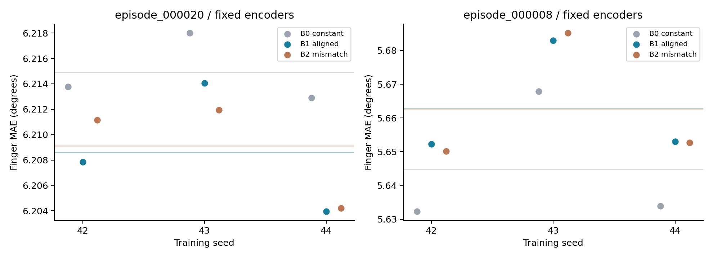
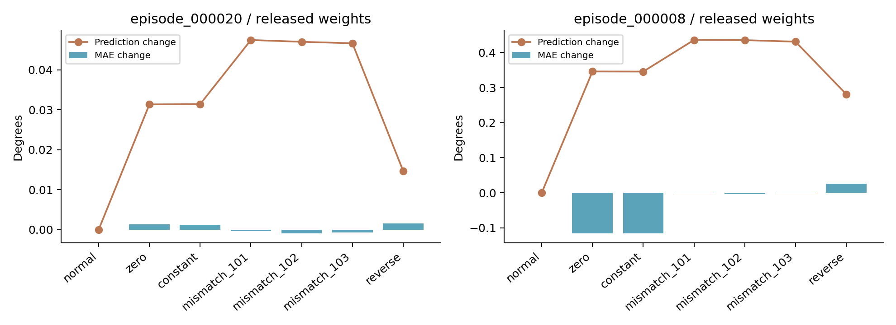
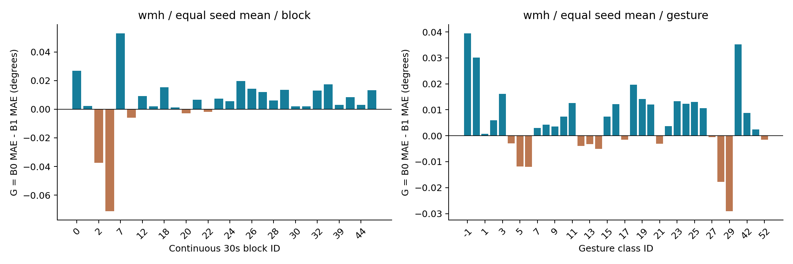
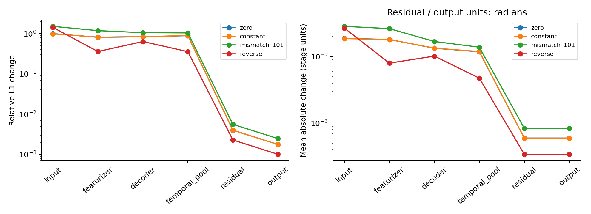

# 有效 EMG 贡献验证：发布权重与匹配局部训练

正式训练日期：2026-10-21；报告整理与均匀时间诊断补充：2026-10-22（Asia/Tokyo）。右手、Preview、20 个手指角度；所有分数单位为度，越低越好。

| 录制 | 训练/评估条件 | 中心数 | MAE 均值 ± seed样本SD | 相对B0收益 G（°） | 相对B0收益 |
| --- | --- | --- | --- | --- | --- |
| episode_000020 | B0_constant | 3507 | 6.214894 ± 0.002728 | +0.000000 | +0.0000% |
| episode_000020 | B1_normal | 3507 | 6.208619 ± 0.005103 | +0.006275 | +0.1010% |
| episode_000020 | B2_mismatch_101 | 3507 | 6.209106 ± 0.004260 | +0.005788 | +0.0931% |
| episode_000008 | B0_constant | 6966 | 5.644711 ± 0.020125 | +0.000000 | +0.0000% |
| episode_000008 | B1_normal | 6966 | 5.662749 ± 0.017552 | -0.018039 | -0.3197% |
| episode_000008 | B2_mismatch_101 | 6966 | 5.662682 ± 0.019528 | -0.017971 | -0.3184% |

| 人 | 录制 | 训练/评估 | seed | 中心 | 有效角度 | MAE | 相对B0收益 | 相对B0收益% | 预测变化对B1正常 |
| --- | --- | --- | --- | --- | --- | --- | --- | --- | --- |
| wmh | episode_000020 | B0_constant | 42 | 3507 | 70140 | 6.213782 | +0.000000 | +0.0000% | 0.066050 |
| wmh | episode_000020 | B1_normal | 42 | 3507 | 70140 | 6.207846 | +0.005936 | +0.0955% | 0.000000 |
| wmh | episode_000020 | B2_mismatch_101 | 42 | 3507 | 70140 | 6.211158 | +0.002624 | +0.0422% | 0.075382 |
| wmh | episode_000020 | B0_constant | 43 | 3507 | 70140 | 6.218002 | +0.000000 | +0.0000% | 0.085140 |
| wmh | episode_000020 | B1_normal | 43 | 3507 | 70140 | 6.214064 | +0.003938 | +0.0633% | 0.000000 |
| wmh | episode_000020 | B2_mismatch_101 | 43 | 3507 | 70140 | 6.211952 | +0.006050 | +0.0973% | 0.093537 |
| wmh | episode_000020 | B0_constant | 44 | 3507 | 70140 | 6.212897 | +0.000000 | +0.0000% | 0.083530 |
| wmh | episode_000020 | B1_normal | 44 | 3507 | 70140 | 6.203947 | +0.008950 | +0.1441% | 0.000000 |
| wmh | episode_000020 | B2_mismatch_101 | 44 | 3507 | 70140 | 6.204208 | +0.008689 | +0.1399% | 0.097810 |
| zbk | episode_000008 | B0_constant | 42 | 6966 | 139320 | 5.632269 | +0.000000 | +0.0000% | 0.119386 |
| zbk | episode_000008 | B1_normal | 42 | 6966 | 139320 | 5.652213 | -0.019943 | -0.3541% | 0.000000 |
| zbk | episode_000008 | B2_mismatch_101 | 42 | 6966 | 139320 | 5.650149 | -0.017880 | -0.3175% | 0.135814 |
| zbk | episode_000008 | B0_constant | 43 | 6966 | 139320 | 5.667929 | +0.000000 | +0.0000% | 0.170478 |
| zbk | episode_000008 | B1_normal | 43 | 6966 | 139320 | 5.683012 | -0.015083 | -0.2661% | 0.000000 |
| zbk | episode_000008 | B2_mismatch_101 | 43 | 6966 | 139320 | 5.685182 | -0.017253 | -0.3044% | 0.188473 |
| zbk | episode_000008 | B0_constant | 44 | 6966 | 139320 | 5.633934 | +0.000000 | +0.0000% | 0.141856 |
| zbk | episode_000008 | B1_normal | 44 | 6966 | 139320 | 5.653024 | -0.019090 | -0.3388% | 0.000000 |
| zbk | episode_000008 | B2_mismatch_101 | 44 | 6966 | 139320 | 5.652715 | -0.018781 | -0.3334% | 0.183963 |

## 结论与下一轮最小实验

episode_000020：G 均值 +0.006275°，seed SD 0.002523°；3/3 seed 为正。连续时间块等权收益 +0.004925°，描述性 bootstrap 95%区间 [-0.003148, +0.012054]°；正收益块 23/28。

episode_000008：G 均值 -0.018039°，seed SD 0.002595°；0/3 seed 为正。连续时间块等权收益 -0.018640°，描述性 bootstrap 95%区间 [-0.027567, -0.010414]°；正收益块 11/40。

episode_000020：B2−B1均值 +0.000487°；把同一B1的输入换成三个错配映射后，平均MAE只改变 -0.000413°，相对B0的收益量为 +0.006688°。训练组之间的MAE差与“正确对齐输入当下提供的信息”应分开看。

episode_000008：B2−B1均值 -0.000067°；把同一B1的输入换成三个错配映射后，平均MAE只改变 +0.003293°，相对B0的收益量为 -0.021332°。训练组之间的MAE差与“正确对齐输入当下提供的信息”应分开看。

**本轮未获得可重复的“正确对齐EMG带来特有收益”的充分证据。** wmh三个seed的B1均略优于B0，但B1与B2排序不稳定，且对同一B1换错配输入并不消除其相对B0的优势。跨录制结果和分块变动进一步限制了这种微小训练组差异的解释。这个结论针对本轮局部训练设置，不是断言EMG没有预测信息。

只有 B1 同时稳定优于 B0/B2、且错配使其失去收益，才支持有效对齐信息贡献。不能把发布融合优于独立视觉模型当作已控制容量的 EMG 收益。结果只适用于给定权重、冻结编码器和本轮预算。

**建议优先追溯并验证输入归一化的训练资产。** 当前执行确认 filtered_paper 使用 legacy raw 标量，但缺少原训练统计文件字节，尚不能判定发布输入应改成其他尺度。下一轮最小实验：取得原训练 stats 文件及版本/日志，先作同一真实窗口的训练/当前张量逐项比对；若确认不一致，再修复个人加载路径并原样重跑 B0/B1/B2。没有证据前不按评估 MAE 选尺度，不自动开展交互结构或超参搜索。

## 发布模型：固定权重配对干预

| 录制 | 条件 | 中心数 | MAE | 相对发布正常 ΔMAE | 预测平均绝对变化 |
| --- | --- | --- | --- | --- | --- |
| episode_000020 | released_visual_branch | 3507 | 12.326312 | +6.079031 | 8.628682 |
| episode_000020 | released_normal | 3507 | 6.247280 | +0.000000 | 0.000000 |
| episode_000020 | released_zero | 3507 | 6.248543 | +0.001263 | 0.031336 |
| episode_000020 | released_constant | 3507 | 6.248500 | +0.001220 | 0.031393 |
| episode_000020 | released_mismatch_101 | 3507 | 6.246954 | -0.000326 | 0.047446 |
| episode_000020 | released_mismatch_102 | 3507 | 6.246386 | -0.000894 | 0.046992 |
| episode_000020 | released_mismatch_103 | 3507 | 6.246618 | -0.000662 | 0.046625 |
| episode_000020 | released_reverse | 3507 | 6.248819 | +0.001539 | 0.014685 |
| episode_000020 | vision_normal | 3507 | 6.870505 | +0.623225 | 4.395192 |
| episode_000008 | released_visual_branch | 6966 | 8.469354 | +2.772658 | 7.320306 |
| episode_000008 | released_normal | 6966 | 5.696696 | +0.000000 | 0.000000 |
| episode_000008 | released_zero | 6966 | 5.581449 | -0.115247 | 0.346013 |
| episode_000008 | released_constant | 6966 | 5.581498 | -0.115198 | 0.345743 |
| episode_000008 | released_mismatch_101 | 6966 | 5.695205 | -0.001490 | 0.435802 |
| episode_000008 | released_mismatch_102 | 6966 | 5.693326 | -0.003369 | 0.435417 |
| episode_000008 | released_mismatch_103 | 6966 | 5.695996 | -0.000700 | 0.431035 |
| episode_000008 | released_reverse | 6966 | 5.722722 | +0.026027 | 0.281316 |
| episode_000008 | vision_normal | 6966 | 5.594647 | -0.102049 | 3.904682 |

F1=normal；F2=归一化后全部槽位置零；F3=原始有效通道常量0经同样布局/归一化；F4=三个预先固定双射（101/102/103）；F5=时间反转。F4 保留完整窗口结构与通道关系、每个 donor 恰好一次，完全保留本池经验边际；同人/同手/同录制/同池/同原split，完整支持不重叠。不同执行优先，不依据预测误差选映射。时间反转保留统计及姿态信息，仅为辅助诊断。独立视觉checkpoint和内部视觉分支的训练历史、表征不同，仅作背景。

wmh完整窗口错配的预测变化约0.047°，MAE近乎不变；zbk预测变化约0.43°，明显大于wmh，而MAE变化仍小。因而弱“误差敏感性”在两录制中出现，但不能据此说zbk模型不使用EMG；个体预测变化会在总体MAE中抵消。zbk常量输入还改善约0.115°，显示该输入条件下EMG并未带来净误差收益。

固定映射不同执行/类别覆盖（完整窗口支持均不重叠，最小中心距离≥7790行）：

| 录制 | 池 | 映射seed | 中心数 | 不同执行数 | 不同类别数 |
| --- | --- | --- | --- | --- | --- |
| episode_000008 | E | 101 | 6966 | 6966 | 6874 |
| episode_000008 | E | 102 | 6966 | 6966 | 6884 |
| episode_000008 | E | 103 | 6966 | 6966 | 6871 |
| episode_000020 | E | 101 | 3507 | 3507 | 3392 |
| episode_000020 | E | 102 | 3507 | 3507 | 3383 |
| episode_000020 | E | 103 | 3507 | 3507 | 3386 |

## B1 输入干预与分组

| 录制 | B1评估输入 | 三seed均值MAE | 预测变化对B1正常 |
| --- | --- | --- | --- |
| episode_000020 | B1_normal | 6.208619 | 0.000000 |
| episode_000020 | B1_constant | 6.208250 | 0.033334 |
| episode_000020 | B1_mismatch_101 | 6.208482 | 0.050719 |
| episode_000020 | B1_mismatch_102 | 6.208070 | 0.050353 |
| episode_000020 | B1_mismatch_103 | 6.208066 | 0.049794 |
| episode_000020 | B1_reverse | 6.210546 | 0.015269 |
| episode_000008 | B1_normal | 5.662749 | 0.000000 |
| episode_000008 | B1_constant | 5.653808 | 0.117906 |
| episode_000008 | B1_mismatch_101 | 5.666035 | 0.156188 |
| episode_000008 | B1_mismatch_102 | 5.666233 | 0.156102 |
| episode_000008 | B1_mismatch_103 | 5.665859 | 0.153930 |
| episode_000008 | B1_reverse | 5.653598 | 0.102060 |

| 录制 | 配对量 | 统计单位 | 单位数 | 等权均值 | 数据单位SD | 描述性95%区间 |
| --- | --- | --- | --- | --- | --- | --- |
| episode_000020 | G_B0_minus_B1 | block | 28 | +0.004925 | 0.020641 | [-0.003148, +0.012054] |
| episode_000020 | G_B0_minus_B1 | execution | 47 | +0.006127 | 0.019266 | [+0.000488, +0.011440] |
| episode_000020 | B2_minus_B1 | block | 28 | -0.000459 | 0.020023 | [-0.007996, +0.006632] |
| episode_000020 | B2_minus_B1 | execution | 47 | +0.000309 | 0.018859 | [-0.005040, +0.005613] |
| episode_000020 | B1_wrong_minus_normal | block | 28 | -0.001783 | 0.016686 | [-0.008439, +0.003592] |
| episode_000020 | B1_wrong_minus_normal | execution | 47 | -0.000262 | 0.015557 | [-0.004891, +0.003899] |
| episode_000008 | G_B0_minus_B1 | block | 40 | -0.018640 | 0.028181 | [-0.027567, -0.010414] |
| episode_000008 | G_B0_minus_B1 | execution | 90 | -0.018176 | 0.033247 | [-0.024997, -0.011350] |
| episode_000008 | B2_minus_B1 | block | 40 | -0.000212 | 0.026166 | [-0.008429, +0.007554] |
| episode_000008 | B2_minus_B1 | execution | 90 | -0.000649 | 0.032573 | [-0.007434, +0.005933] |
| episode_000008 | B1_wrong_minus_normal | block | 40 | +0.002842 | 0.019767 | [-0.003195, +0.008964] |
| episode_000008 | B1_wrong_minus_normal | execution | 90 | +0.003726 | 0.022833 | [-0.000960, +0.008392] |

时间块按每段原 split 内30秒名义行时间定义；动作执行按连续（gesture class, active）定义，不因split切换人为新增。相邻窗口仍重叠，跨块边界可能共享少量输入，因此区间只描述这批录制的块变动，不是独立参与者置信区间。bootstrap先在每块内对seed取均值，再重采样块10000次；seed SD单独报告。按动作、原split、执行和时间块的全部逐seed汇总见 [group_metrics.csv](group_metrics.csv)，逐块配对量见 [paired_units.csv](paired_units.csv)。未把重叠窗口当作独立重复。未开展遮挡/信号质量机制归因。

## 输入与 EMG 路径

详见 [输入核查表](input_audit.md)、[阶段追踪](path_trace.csv) 和 [通道分布](input_channels.csv)。阶段绝对差与相对L1/L2差均保留，残差/输出单位为rad，其他阶段为各自特征单位；不能横向把不同阶段绝对幅值当作同一物理量。选窗仅由训练中心时刻决定：24个均匀名义时间目标，各取最近合格训练中心，去重后实际窗口数见path_trace.json。此诊断补充在训练完成后以未更新发布权重执行，不使用预测误差；初版按合格序列下标均匀抽样的追踪留在完整run根目录，未覆盖。

| 常量干预阶段 | 基准meanabs | 干预meanabs | 绝对mean变化 | 相对L1变化 |
| --- | --- | --- | --- | --- |
| input | 0.01886504 | 0.00030374 | 0.01871233 | 0.991905 |
| featurizer | 0.02229255 | 0.01933036 | 0.01813609 | 0.813549 |
| decoder | 0.01602261 | 0.01802058 | 0.01347505 | 0.841002 |
| temporal_pool | 0.01331593 | 0.01802058 | 0.01193515 | 0.896306 |
| residual | 0.14900772 | 0.14904356 | 0.00059512 | 0.003994 |
| output | 0.33759400 | 0.33761519 | 0.00059512 | 0.001763 |

该批次常量干预在池化表征上仍有显著相对变化，而输出变化很小；弱依赖不等于输入未到达模型。变化在池化之后的融合投影与残差head中被大幅压低，支持优先排查已有融合路径对EMG的使用方式。这里未分离两层各自作用，也未证明归一化是唯一原因。

采样率按名义2kHz计算窗口长度；全录制timestamp跨度推算wmh约2000.012Hz、zbk约2000.015Hz，但逐行timestamp_us并非均匀采样时间（中位相邻差1μs，存在相同时间戳与约8.5ms跳变）。加载器使用原行序与中心，不按该时间戳重采样；上游packet到达时间与采样时刻关系仍未完全追溯，不能据此擅自修索引。

局部常量干预若依然留下非零 decoder 特征，不代表残留有效EMG信息：编码器偏置/归一化/位置编码可生成常量特征。残差路径同时接收视觉，残差大也不证明EMG贡献。当前审计未确认单位、索引或布局错误；没有执行依据评估分数挑选的尺度“修复”。legacy缩放可能压低特征差异只是待验证机制，尚不能据此确定病因。

## 样本与训练协议

episode_000020（wmh）：候选 7828，资格通过 7681；T=4174，E=3507。排除计数：`{"eligible": 7681, "missing_crop": 147}`。 历史manifest哈希验证通过，标签逐项重读核对，中心按原12,000行/stride200协议复核重建；中心差异见selection_audit。

episode_000008（zbk）：候选 6966，资格通过 6966；T=0，E=6966。排除计数：`{"eligible": 6966}`。 未复用历史中心，按原12,000行/stride200完整split支持协议重建到本次目录。

所有正式比较共用相同E中心、RGB、参考及掩码；资格在评分前固定，检查标签、全窗口有限性和crop解码。训练与评估完整7790行支持隔离，且沿用历史12000行安全边界。RGB要求映射非负、stale=false、|delta_ms|≤50、uint8 crop可解码和预处理有限。训练窗口资格与评估独立检查。

B0/B1/B2分别复制发布时间池、vision projection、fusion projection及residual head；共享冻结eval/no_grad的featurizer、decoder、视觉backbone及视觉head。每seed三组初值相同、数据顺序相同、配对批次dropout随机数相同。Adam lr=1e-4、weight_decay=1e-4、batch32、10epochs、FP32，matmul/cuDNN TF32关闭。前20维MAE loss；仅评估最后epoch。B2每epoch由seed固定训练池内错配双射，评估使用固定101映射；训练映射不使用评估池。zbk上只冻结复核，不训练或调参；wmh模型直接用于zbk同协议E池。

参数每组 684,695。三seed合计训练 529.9s；峰值allocated 493.2MiB，reserved 768.0MiB。含资格扫描/多干预评估的完整运行 939.2s。输入直接读取D盘，没有复制memmap、crop、视频或批量特征。

## 验证、来源与限制

本次实际执行：真实输入smoke、wmh与zbk发布融合F1–F5、独立视觉背景、wmh三seed×B0/B1/B2训练、每个B1的正常/常量/三个错配/反转、wmh模型对zbk的固定复核；从本次保存预测独立float64重算全部MAE和分组。复用历史仅限wmh中心选择与背景协议，没有复用历史预测作为本次实验数值。

运行检查：原PoolingBranch与发布forward逐批一致；冻结模型完整state_dict（含BN buffers）训练前后SHA相同；每组保存参数重新加载预测最大差为0rad；所有比较的中心/图像/参考/掩码逐项一致。针对性pytest、复算和快照校验见 [validation.json](validation.json)。完整命令与环境见 [settings.json](settings.json)，所有输入/脚本哈希保留。

已有wmh评估池属于开发证据；checkpoint参与者训练暴露尚未完全追溯；zbk只是不同录制上的冻结复核，不能称未见参与者测试。预处理含非因果滤波，窗口重叠；不是官方benchmark，不外推至全部数据、双手44维或在线部署。没有重跑原始数据预处理，也没有恢复缺失的原训练stats内容。当前结果不证明EMG在其他表征/训练预算下没有信息。

完整本地运行：`myself/outputs/2026-10-21_wmh_right_effective_emg_full_01`。执行HEAD `c2a6038ccd5e89bc562b33b7d63b446335742739`。本次为未提交、未推送的本地工作；结果导出日期与执行身份分别记录在manifest。
