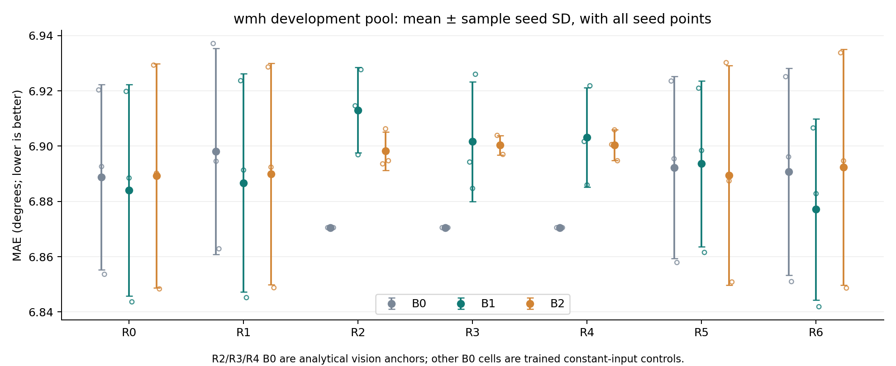
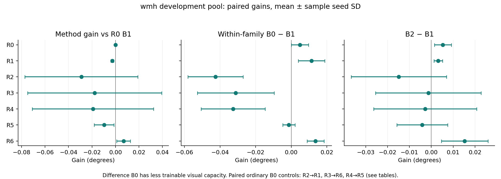
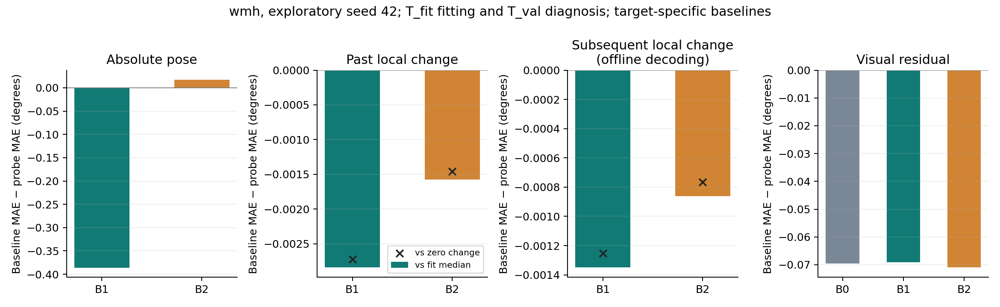
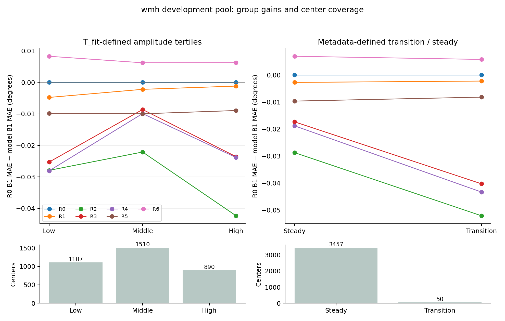
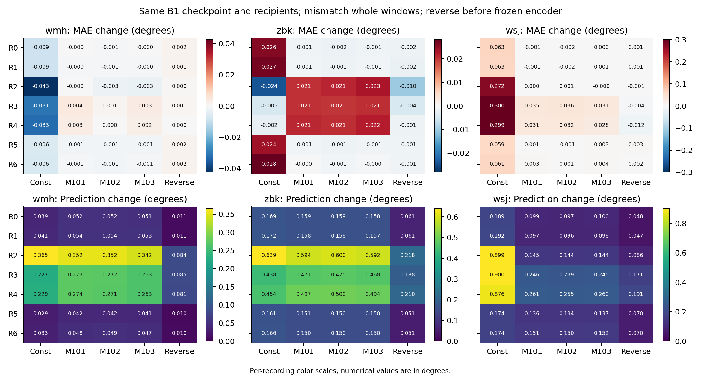
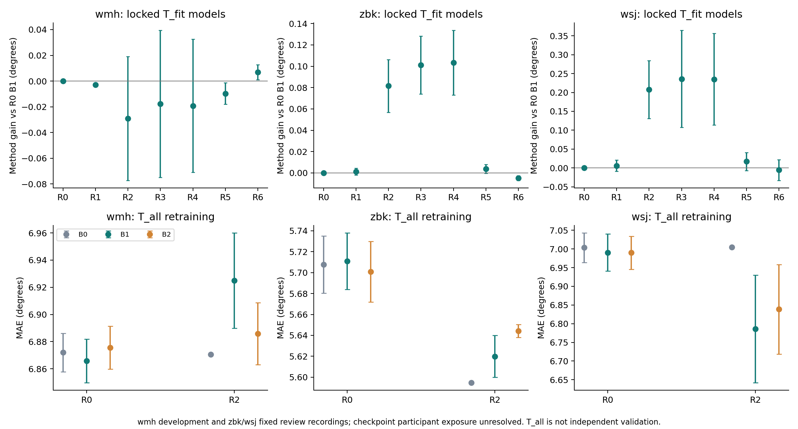
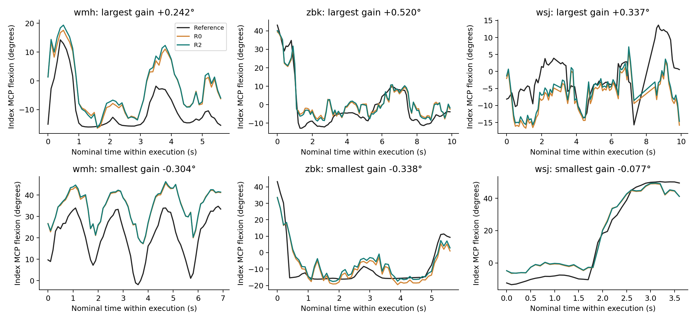

# EMG information, finger queries and dynamic supervision

Offline Preview right-hand study; 20 finger angles. All MAEs are in degrees (lower is better). Primary results use the final epoch and the mean of three separately scored seeds; error bars are sample seed SD.

Current-round controlled matrix on wmh development data.

## Findings

**Selection is not evidence of improvement.** The rule selected R2 at T_val 1.663904°, while the fixed visual anchor scored 1.659094°. The selected family was retained for all later comparisons regardless of its E performance.

On wmh, R6 B1 scored 6.877101° versus R0 B1 6.883981° (method gain +0.006880°). Its same-checkpoint mismatch intervention changed MAE by -0.001024° on average, so this small training-group improvement is not supported as a correct-EMG-specific benefit.

The exploratory correct-EMG probes did not beat their own fit-median baselines on T_val; change probes also failed to beat zero change. This is a negative result for these frozen features, readers and budget, not a claim that EMG lacks task information. Sensitivity, decodability and useful conditional increment remain distinct.

T_all did not rescue the selected R2 on wmh: R0 B1=6.865718°, R2 B1=6.925017°. R2 retained lower MAE than R0 on the two review recordings, but its same-family anchor and mismatch controls are needed before attributing that difference to correct EMG.

**A limited positive conditional result appears on wsj.** R3 improves the vision anchor from 7.005121° to 6.705028°. Mismatching the same R3 checkpoint worsens MAE by +0.033966° on average, but most of the anchor-relative gain survives mismatch. This pool contains only 216 centers from three executions, all steady under the predefined rule. It supports further replication of pose-supervised reference differences, not a broad transfer or transition claim.

Method improvement, within-family EMG gain and wrong-window training are separate comparisons.

Exploratory feature decodability relative to each target’s own baseline.

Dynamic groups and their exact center coverage.

Performance changes and prediction sensitivity under the same B1 checkpoint.

Locked review recordings and T_all retraining, shown separately.

Largest and smallest execution-level method gains across all 20 angles; fixed joint 5 is shown. Seed-mean trajectories are illustrative, not the primary scoring estimator.

## Main evidence

T_val selected **R2** before every formal E error score. The complete selection rule and all seed scores are in [selection_lock.json](selection_lock.json). The E_dev pool is wmh; zbk and wsj are fixed review recordings excluded from fitting and method selection. These are not an unseen-participant benchmark.

### Controlled T_fit models

| Phase | Recording | Family | B0 mean ± SD | B1 mean ± SD | B2 mean ± SD | G_method | G_EMG | B2−B1 |
| --- | --- | --- | ---: | ---: | ---: | ---: | ---: | ---: |
| fit | zbk | R0 | 5.703423 ± 0.032619 | 5.700372 ± 0.037511 | 5.695973 ± 0.031305 | +0.000000 | +0.003050 | -0.004399 |
| fit | zbk | R1 | 5.697702 ± 0.036803 | 5.699088 ± 0.039826 | 5.694567 ± 0.031654 | +0.001284 | -0.001386 | -0.004520 |
| fit | zbk | R2 | 5.594647 ± 0.000000 | 5.618824 ± 0.024189 | 5.644895 ± 0.009984 | +0.081549 | -0.024177 | +0.026071 |
| fit | zbk | R3 | 5.594647 ± 0.000000 | 5.599159 ± 0.022607 | 5.648141 ± 0.011084 | +0.101214 | -0.004512 | +0.048982 |
| fit | zbk | R4 | 5.594647 ± 0.000000 | 5.596944 ± 0.021489 | 5.648136 ± 0.008032 | +0.103428 | -0.002298 | +0.051192 |
| fit | zbk | R5 | 5.702238 ± 0.033798 | 5.696486 ± 0.034175 | 5.696748 ± 0.034238 | +0.003887 | +0.005752 | +0.000262 |
| fit | zbk | R6 | 5.700393 ± 0.036850 | 5.705195 ± 0.037121 | 5.693542 ± 0.036618 | -0.004823 | -0.004802 | -0.011654 |
| fit | wmh | R0 | 6.888866 ± 0.033521 | 6.883981 ± 0.038279 | 6.889305 ± 0.040503 | +0.000000 | +0.004885 | +0.005324 |
| fit | wmh | R1 | 6.898178 ± 0.037278 | 6.886742 ± 0.039456 | 6.889945 ± 0.039999 | -0.002762 | +0.011435 | +0.003202 |
| fit | wmh | R2 | 6.870505 ± 0.000000 | 6.913062 ± 0.015452 | 6.898204 ± 0.007018 | -0.029081 | -0.042557 | -0.014858 |
| fit | wmh | R3 | 6.870505 ± 0.000000 | 6.901660 ± 0.021633 | 6.900326 ± 0.003451 | -0.017679 | -0.031155 | -0.001334 |
| fit | wmh | R4 | 6.870505 ± 0.000000 | 6.903164 ± 0.017986 | 6.900405 ± 0.005581 | -0.019183 | -0.032659 | -0.002759 |
| fit | wmh | R5 | 6.892305 ± 0.032955 | 6.893649 ± 0.030003 | 6.889505 ± 0.039735 | -0.009668 | -0.001344 | -0.004143 |
| fit | wmh | R6 | 6.890756 ± 0.037373 | 6.877101 ± 0.032727 | 6.892381 ± 0.042621 | +0.006880 | +0.013655 | +0.015280 |
| fit | wsj | R0 | 6.986007 ± 0.047431 | 6.940966 ± 0.064770 | 6.964664 ± 0.054140 | +0.000000 | +0.045041 | +0.023698 |
| fit | wsj | R1 | 6.983180 ± 0.078356 | 6.934787 ± 0.055898 | 6.980023 ± 0.050933 | +0.006178 | +0.048393 | +0.045236 |
| fit | wsj | R2 | 7.005121 ± 0.000000 | 6.733137 ± 0.078595 | 6.820412 ± 0.031222 | +0.207829 | +0.271984 | +0.087274 |
| fit | wsj | R3 | 7.005121 ± 0.000000 | 6.705028 ± 0.120312 | 6.871604 ± 0.018411 | +0.235938 | +0.300093 | +0.166576 |
| fit | wsj | R4 | 7.005121 ± 0.000000 | 6.705975 ± 0.104255 | 6.857702 ± 0.016082 | +0.234991 | +0.299146 | +0.151727 |
| fit | wsj | R5 | 6.988582 ± 0.052000 | 6.923625 ± 0.069243 | 6.985891 ± 0.057696 | +0.017341 | +0.064958 | +0.062266 |
| fit | wsj | R6 | 6.993013 ± 0.043765 | 6.946228 ± 0.061901 | 6.978194 ± 0.053711 | -0.005263 | +0.046784 | +0.031965 |

### Fresh T_all retraining

| Phase | Recording | Family | B0 mean ± SD | B1 mean ± SD | B2 mean ± SD | G_method | G_EMG | B2−B1 |
| --- | --- | --- | ---: | ---: | ---: | ---: | ---: | ---: |
| all | zbk | R0 | 5.707637 ± 0.027402 | 5.711000 ± 0.027113 | 5.700951 ± 0.028908 | +0.000000 | -0.003363 | -0.010049 |
| all | zbk | R2 | 5.594647 ± 0.000000 | 5.619893 ± 0.020069 | 5.644230 ± 0.006064 | +0.091107 | -0.025246 | +0.024337 |
| all | wmh | R0 | 6.871957 ± 0.014168 | 6.865718 ± 0.016008 | 6.875551 ± 0.015846 | +0.000000 | +0.006239 | +0.009833 |
| all | wmh | R2 | 6.870505 ± 0.000000 | 6.925017 ± 0.035118 | 6.885885 ± 0.022753 | -0.059299 | -0.054512 | -0.039132 |
| all | wsj | R0 | 7.003541 ± 0.039767 | 6.990585 ± 0.049739 | 6.989778 ± 0.044359 | +0.000000 | +0.012956 | -0.000808 |
| all | wsj | R2 | 7.005121 ± 0.000000 | 6.786038 ± 0.144091 | 6.838491 ± 0.119577 | +0.204548 | +0.219084 | +0.052454 |

**B0 interpretation:** R2/R3/R4 use the fixed independent vision anchor by algebra. R0/R1/R5/R6 B0 are optimized constant-input visual-capacity controls. For reference-difference models, [effects_by_seed.csv](effects_by_seed.csv) also reports gains against R1/R6/R5 B0 respectively. Winning against an anchor alone does not establish an EMG-specific benefit.

**Comparison definitions:** G_method = current-round R0_B1 MAE − family B1 MAE. G_EMG = same-family B0 − B1. B2 uses mismatched training and fixed mismatch-101 inference; correct-input B2 scores and all three inference maps are retained in [interventions.csv](interventions.csv). No historical model score is substituted for R0.

## Feature information and supervision

| Target | Input | T_val MAE | Fit-median baseline | Gain vs median | Gain vs zero |
| --- | --- | ---: | ---: | ---: | ---: |
| minus | B1 | 1.462387 | 1.459548 | -0.002839 | -0.002718 |
| minus | B2 | 1.461124 | 1.459548 | -0.001576 | -0.001455 |
| plus | B1 | 1.404894 | 1.403545 | -0.001349 | -0.001251 |
| plus | B2 | 1.404406 | 1.403545 | -0.000862 | -0.000764 |
| pose | B1 | 10.562667 | 10.176296 | -0.386371 | +7.144824 |
| pose | B2 | 10.158563 | 10.176296 | +0.017733 | +7.548927 |
| visual_residual | B0 | 1.732972 | 1.663381 | -0.069591 | -0.073878 |
| visual_residual | B1 | 1.732468 | 1.663381 | -0.069087 | -0.073374 |
| visual_residual | B2 | 1.734336 | 1.663381 | -0.070955 | -0.075242 |

All probes use the same ordered temporal reader and seed 42, fit only on T_fit. Each target has its own fit-only joint-median baseline; change targets also have a zero-change baseline. Raw MAEs across targets are not measures of relative information content. P3 is **offline local-change decoding**, because the EMG input includes future context. Visual-residual probes compare constant, correct and mismatched EMG under the same visual condition. Independent decodability is not equivalent to a conditional visual increment.

Paired supervision contrasts are R2→R3 and R1→R6 (pose), R3→R4 and R6→R5 (additional dynamics). Reference subtraction contrasts are R1↔R2, R6↔R3 and R5↔R4. [group_gains.csv](group_gains.csv) reports all directions, including worsening, rather than selecting favorable joints or transitions.

## Fixed protocol and coverage

Execution checkout: `main` at `d7f55cfd30a93807641d93190f93e2ce240f71fa`. Execution identity: `c49b1625007ade78fc323ec0bcca509e1357c01d417aaf0966626a94778c69e0`. The requested branch name was not forced; no checkout, reset, pull, commit or push was performed.

Adam lr=1e-4, weight decay=1e-4, 30 epochs, effective batch **128**, seeds 42/43/44, FP32 and TF32 off, last epoch primary. The user explicitly authorized the hardware-driven batch adjustment before E scoring. Encoding batch is 128. The superseded batch-32 run remains preserved and contributes no results here.

Whole continuous gesture/active execution IDs are created across the recording independently of original split boundaries. Seed 20261028 allocates approximately 20% of the **train execution groups** to T_val; support-boundary purging changes the retained center ratio. T_fit=3,071, T_val=518, purged=585, T_all=4,174. The retained fit/validation split is about 85.6/14.4% by centers, not exactly 80/20. E centers: wmh 3,507; zbk 6,966; wsj 216. Counts were reconstructed/revalidated, not hard-coded for selection. [coverage.csv](coverage.csv) records valid auxiliary coverage and original exclusions.

Actual EMG support is [center−3895, center+3895), within a single recording and original split, with finite full EMG input. Historical 12,000-row qualification is retained. Auxiliary labels at ±200 nominal 2-kHz rows are checked independently and masked per target; missing dynamics never remove a main-pose score. The selected crop has valid decoding, non-stale mapping and |alignment delta|≤50 ms; its mapped center is within the much wider EMG support. All primary conditions share centers, images, labels and masks.

Donors form same-pool, same-recording/right-hand/original-split bijections with nonoverlapping complete supports, preferring different executions. Training maps change per epoch, inference maps use seeds 101/102/103. Donor labels are never used. Input reversal occurs before the frozen encoder. [verification.json](verification.json) verifies saved orders/maps and the selection/score chronology.

The released fusion supplies its own strictly loaded EMG featurizer/decoder, never a substituted EMGFormer-M. The shared visual anchor is strictly loaded independent vision_resnet18.ckpt. The unmodified fusion wrapper and independent map→original pooling/head were verified separately. New residual heads start at the independent visual anchor, not the historical full-fusion output.

All families share a 128-wide adapter, 5 finger queries, 4 attention heads, one interaction block, 4×4 visual tokens with 2D positions, global visual/anchor conditioning, ordered 146×256 EMG decoder features, and a zero-initialized per-finger output. R0 adds an attention pool reducing 146 EMG tokens to one; R1–R6 read all 146. R0 has 8,321 additional active pooling parameters. Decoder positions are ordered indices, not a verified physical receptive-field map. No new multiscale/lag/gate module was added.

R1/R2 share every tensor shape and initialization; only H(q,E_ref) subtraction changes. Reference physical zero goes through the actual sparse layout, scalar normalization and frozen encoder. Reference features before the adapter may be reused; the current adapter/H is always recomputed with gradients in both branches. New dropout is zero. The cancellation, mixed q/E interaction, zero-init first-output gradient, subsequent adapter/query gradients, auxiliary-only adapter gradient, frozen state/BN and checkpoint reload were tested.

The local normalization audit found no definite implementation error: filtered_paper currently falls back to legacy egoemg scalar statistics, as historically validated. Padded slots are normalized with the same scalar. Original training-statistics bytes/hash remain unavailable; this study fixes the existing protocol and does not select a scale by E error.

R3/R6 supervise EMG-only pose; R4/R5 also supervise past/subsequent changes. All enabled coefficients are 1 and use masked per-angle L1 in radians. Auxiliary heads read the adapter used by fusion and never read vision. The final prediction is absolute pose; no dynamics integration is performed. Analytical B0 cells do not claim trained auxiliary performance.

T_all retraining begins from the original seed-specific initialization, not the selected T_fit checkpoint. Former T_val is included in fitting; no new checkpoint selection is applied. Its comparison answers performance after using all eligible wmh train data and is not a second independent validation.

## Execution, uncertainty and reproducibility

Primary planned cells: 63; actual optimization: 54; analytical reuse: 9. Including T_all: 81 logical cells, 69 optimization cells, 12 analytical cells, 0 failed, 0 missing.

All primary metrics were independently recomputed from saved predictions with NumPy float64, without importing the training metric or model. Split, execution, block, joint, finger, transition and dynamic-bin weighted sums reconcile with overall valid-angle-weighted MAE. Seed means are not ensemble MAEs. Full predictions/checkpoints/logs remain in ignored outputs.

Execution-level paired distributions and descriptive bootstrap intervals are in [execution_intervals.csv](execution_intervals.csv). These are descriptive recording-level variation, not confidence intervals for new participants. Adjacent executions can share contextual windows, and 30-second center blocks do not guarantee disjoint support. Overlapping windows are not counted as independent experimental repeats.

Resource accounting is in [resources.csv](resources.csv) and [profile.json](profile.json). Cached-head timings and actual read+frozen-backbone+head timings are distinguished; pipeline timing uses warmed OS caches and repeated direct input reads. Batch sizes, CUDA synchronization, device and included components are recorded. Auxiliary heads are excluded from inference parameter counts.

Historical full-fusion matching scores (different anchor, architecture and 10-epoch protocol) are background only: wmh B0/B1/B2=6.214894/6.208619/6.209106°, zbk=5.644711/5.662749/5.662682°. Their differences from this suite cannot be assigned to one new fusion module.

Limitations: one fitted recording, small wsj review coverage, offline future-context input, correlated windows, unresolved checkpoint participant exposure and original statistics provenance. Negative outcomes do not imply near-zero conditional mutual information. Reference subtraction enforces zero at E_ref but can still use signal presence to enable visual correction; it does not remove all visual shortcuts.

The most useful next experiment must distinguish visual-capacity correction from correct-window information and confirm the observed patterns in genuinely new recordings. Attention, gradients and feature sensitivity establish pathways, not useful causal contribution.

Reproduction commands are in the [workflow](../../docs/emg_innovation_suite.md). Snapshot export identity and checkout commit are not the original execution identity. All changes are local; no commit or push was made.

## Paired architecture and supervision contrasts

Positive values mean the target B1 family has lower MAE. These are descriptive fixed contrasts; no new family was selected from E.

| Contrast | Question | wmh gain | zbk gain | wsj gain |
| --- | --- | ---: | ---: | ---: |
| R0→R1 | pooled_vs_direct | -0.002762 | +0.001284 | +0.006178 |
| R1→R2 | difference_no_aux | -0.026319 | +0.080264 | +0.201650 |
| R6→R3 | difference_pose_aux | -0.024558 | +0.106036 | +0.241201 |
| R5→R4 | difference_dynamic_aux | -0.009516 | +0.099541 | +0.217650 |
| R2→R3 | pose_aux_difference | +0.011402 | +0.019665 | +0.028109 |
| R1→R6 | pose_aux_ordinary | +0.009641 | -0.006107 | -0.011441 |
| R3→R4 | extra_dynamics_difference | -0.001505 | +0.002214 | -0.000947 |
| R6→R5 | extra_dynamics_ordinary | -0.016547 | +0.008709 | +0.022604 |

### Additional dynamic supervision on transition centers

Transition is fixed from metadata, not visual error. Small coverage and contextual overlap limit interpretation. [supervision_contrasts.csv](supervision_contrasts.csv) also retains steady and amplitude groups.

| Contrast | wmh gain | zbk gain | wsj gain |
| --- | ---: | ---: | ---: |
| R3→R4 | -0.003046 | +0.004406 | not covered |
| R6→R5 | -0.013959 | +0.011093 | not covered |
